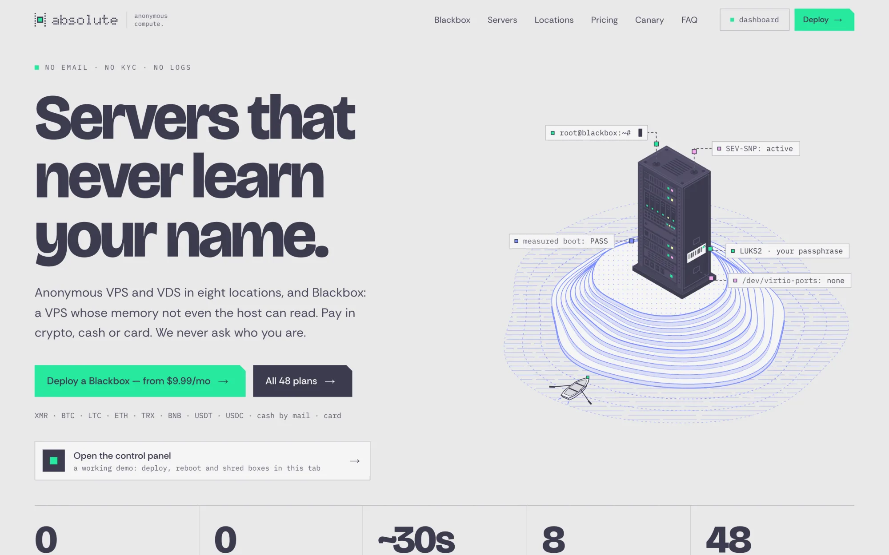
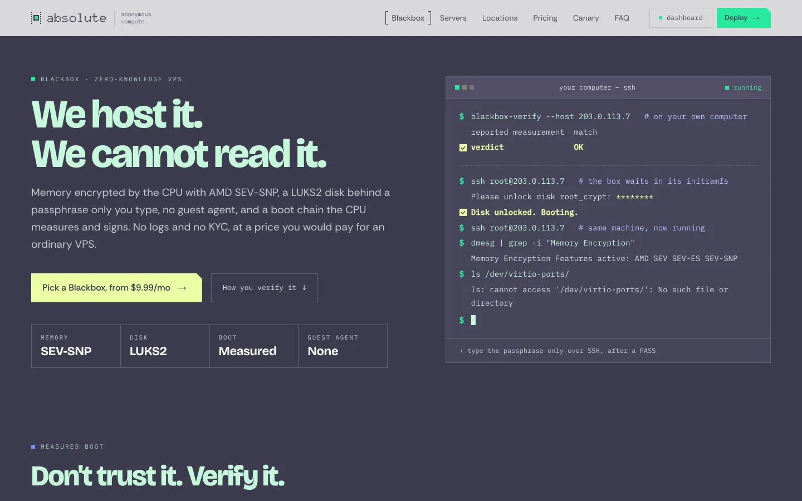
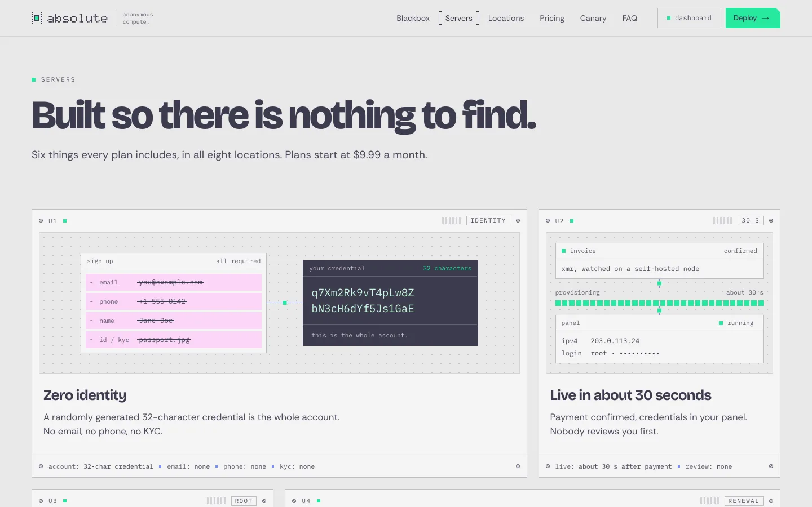
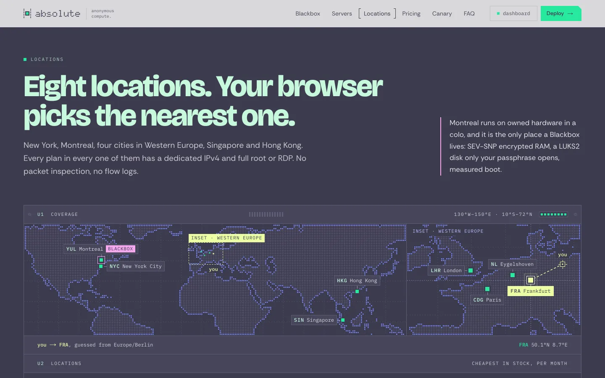
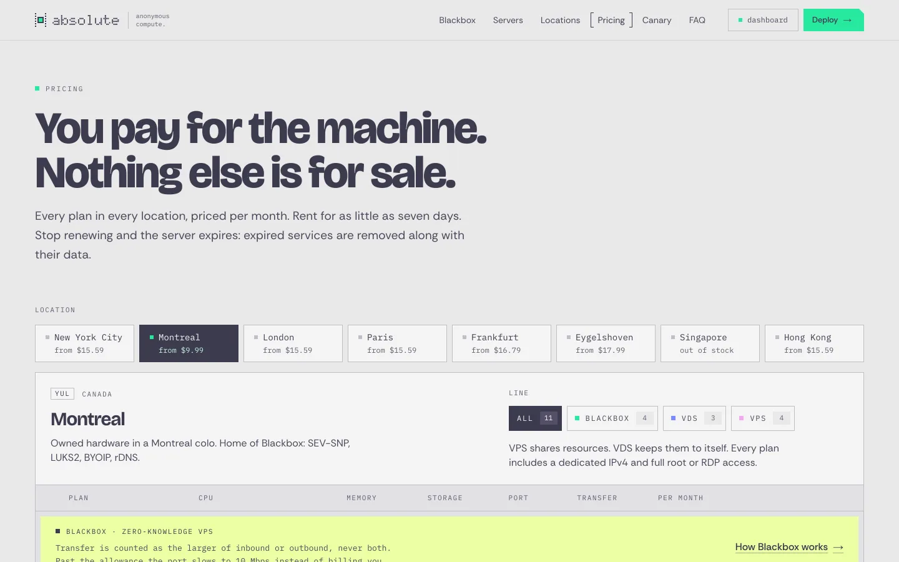
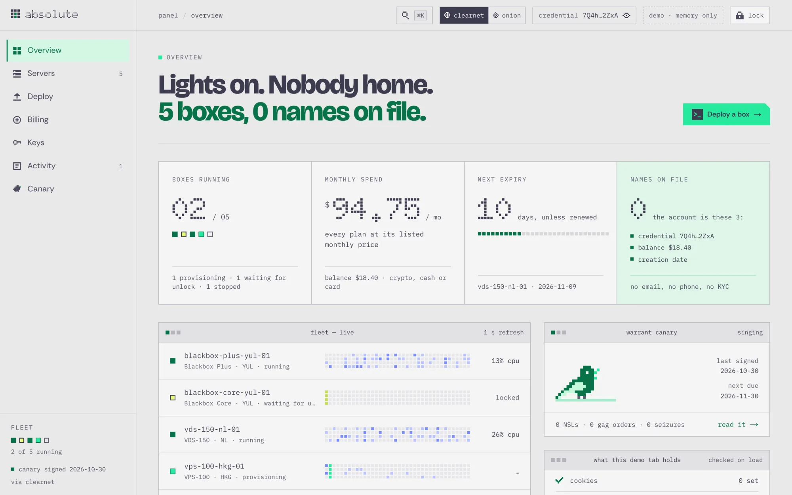
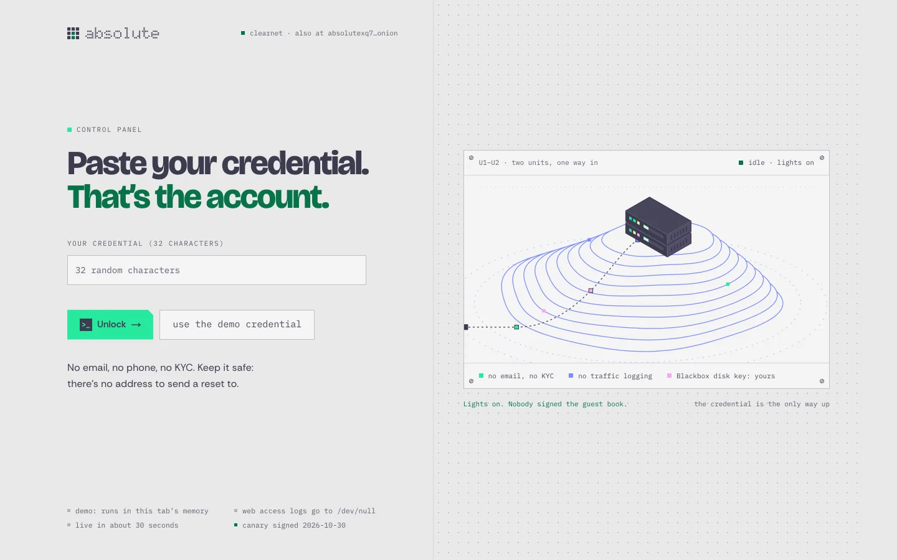
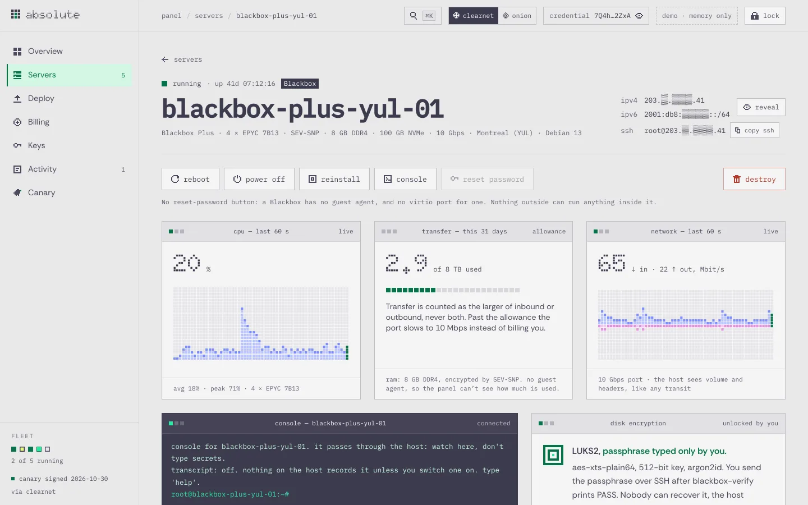
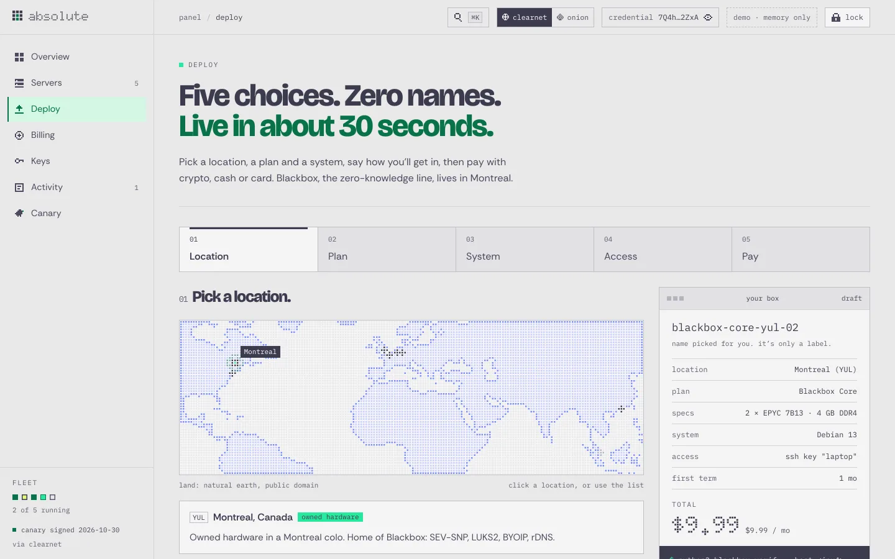
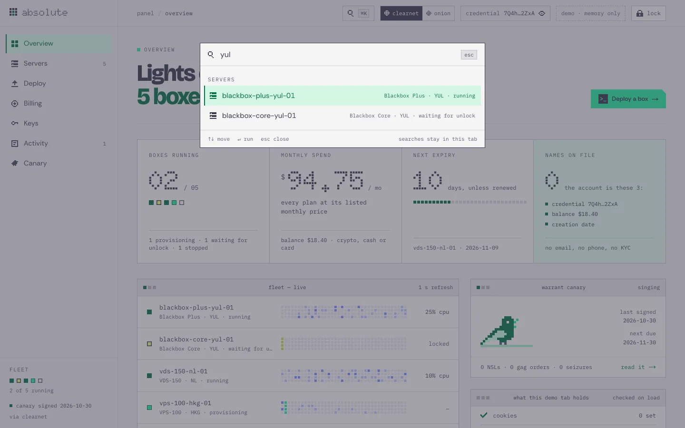

<div align="center">

<a href="https://absolute.kiraa-7e4.workers.dev">
  <picture>
    <source media="(prefers-color-scheme: dark)" srcset="https://ascii.rest/banner/absolute.dark.svg?color=28e99f,ecffa3&tagline=servers%20that%20never%20learn%20your%20name">
    
  </picture>
</a>

<br>
<br>

<a href="https://absolute.kiraa-7e4.workers.dev"></a>

<br>

The landing page and control panel for absolute: anonymous servers, and Blackbox, a VPS whose memory the host can't read.<br>
Next.js, Tailwind and drawings in code, with a panel you can click through in the browser.

[live site](https://absolute.kiraa-7e4.workers.dev) · [open the panel](https://absolute.kiraa-7e4.workers.dev/dashboard?demo) · [run it](#run-it) · [what's on the page](#whats-on-the-page) · [the control panel](#the-control-panel) · [how it's built](#how-its-built) · [contributing](CONTRIBUTING.md)

[](https://github.com/bas3line)
[](https://github.com/bas3line/absolute/actions/workflows/ci.yml)
[](LICENSE)
[](tsconfig.json)
[](package.json)
[](wrangler.jsonc)

</div>

<br>

Written in TypeScript by [@bas3line](https://github.com/bas3line). Two halves. A page that makes the case for servers that never learn your name: an island with one rack on it, a boot chain that measures itself while you watch, a database query that comes back with zero rows, and a map that guesses your nearest location from your clock. And the control panel behind it, which works: unlock it, deploy a box, watch it boot, open its console, reboot it, shred it. No UI kit, no chart or animation library: the drawings are SVG, canvas and CSS, and the only runtime dependencies are Next.js and React.

<p align="center">
  
  
</p>
<p align="center">
  
  
</p>

## Why

Most hosting pages are a globe, three feature cards and a pricing table. absolute sells one idea, a server that doesn't know who rents it, so the page shows it instead of saying it: a sign-up that asks for nothing beside one that asks for a passport, a ledger of what other hosts keep, the boot measurement you check from your own machine before you type a passphrase. And a promise about a control panel is cheap, so the panel is here too, as a demo you can use.

## Run it

```sh
git clone https://github.com/bas3line/absolute
cd absolute
npm install
npm run dev        # http://localhost:3000
```

Node 20.9 or later.

| script | |
| --- | --- |
| `npm run dev` | the site with hot reload |
| `npm run check` | typecheck, lint and a production build; what CI runs |
| `npm run build` | the static site in `out/` |
| `npm run preview` | the build, served by Wrangler the way Cloudflare will serve it (http://localhost:8787) |
| `npm run deploy` | build, then deploy to your own Cloudflare account |

It deploys as a [Cloudflare Worker with static assets](https://developers.cloudflare.com/workers/static-assets/) (`wrangler.jsonc`). `next build` exports every page, the panel's included, as plain HTML, CSS and JS, so anything that serves a folder works too.

## The control panel

<a href="https://absolute.kiraa-7e4.workers.dev/dashboard?demo"></a>

Open it from the hero, the nav or the footer, or go straight to [`/dashboard?demo`](https://absolute.kiraa-7e4.workers.dev/dashboard?demo): the demo credential types itself in and the panel opens. At plain [`/dashboard`](https://absolute.kiraa-7e4.workers.dev/dashboard), any 32 characters unlock it, and "use the demo credential" fills one in. Every credential opens the same demo account: five boxes, two SSH keys, seven invoices and a balance.

<p align="center">
  
  
</p>
<p align="center">
  
  
</p>

| part | what it does | file |
| --- | --- | --- |
| Gate | paste a credential; while it unlocks, 24 cells light in a fixed shuffle, three lines print, and a line sweeps the contour drawing | `Gate.tsx`, `GateIsland.tsx` |
| Shell | sidebar with live counts and one LED per box, a drawer on phones, breadcrumbs, a clearnet/onion switch, a credential chip that reveals and copies, and lock | `Shell.tsx` |
| Command palette | ⌘K or Ctrl+K, or `/` when you aren't typing: every page, every box and a few actions, driven from the keyboard | `Palette.tsx` |
| Overview | boxes running, monthly spend, next expiry and names on file (0); a live fleet of LED strips whose density follows each box's CPU; spend by box; a panel that counts what this tab really stores | `Overview.tsx`, `charts.tsx` |
| Servers | filter by state; a table on a laptop and cards on a phone; addresses masked until you reveal them, and a CPU sparkbar per box | `Servers.tsx` |
| A server | reboot, power, reinstall, reset password and destroy; a minute of live CPU, memory and network charts; on a Blackbox, attestation, disk encryption and the verify-then-unlock commands | `ServerDetail.tsx` |
| Console | a shell that answers about twenty commands from memory, with history; offline unless the box is running | `Console.tsx` |
| Shred | destroying a box breaks its name into cells that flash and fall, then it's gone from the list | `Shred.tsx` |
| Deploy | five steps: location on a map, plan and term, system, access, pay; then the box boots for about 30 seconds while its steps print | `Deploy.tsx`, `MiniMap.tsx` |
| Pay | crypto with a QR that scans as nothing, cash by mail, or card; "simulate payment" confirms after a moment | `Pay.tsx` |
| Billing | balance, renewals with auto or manual renew, invoices, and add credit | `Billing.tsx` |
| Keys | add or remove SSH keys (private keys are refused), and what the account holds next to what it never asks for | `Keys.tsx` |
| Activity | an access log with 0 lines, and what you did this session, which you can forget | `Activity.tsx` |
| Canary | twelve monthly statements, a pixel bird that sings, and the command to verify one | `CanaryView.tsx` |

Everything happens in your tab's memory. The session is one reducer above every panel route, so it survives moving between pages and nothing else: nothing is sent anywhere, nothing is written to cookies or storage, and a reload or lock forgets it. Payments, power, the console, telemetry, attestation and key fingerprints are simulated, and every IP address is from a documentation range.

## What's on the page

| section | what it does | file |
| --- | --- | --- |
| Nav | a clear bar over the hero that turns to paper with a hairline once the page moves; the section in view gets brackets; "dashboard" opens the panel | `Nav.tsx` |
| Hero | the island: an isometric server rack on contour lines, a rowing boat, and a pixel running down each of five labelled wires; a card that opens the panel; a rail of the numbers that matter (0 emails, 0 KYC checks) | `Hero.tsx`, `HeroIsland.tsx` |
| Blackbox | a terminal types the verify-then-unlock session; a wiring diagram runs pixels from four boot inputs to one measurement the CPU signs; eight guarantees with their proofs, the four tiers as 1U blades, and the limits | `Blackbox.tsx`, `BlackboxTerminal.tsx`, `BlackboxChain.tsx`, `BlackboxGuarantees.tsx`, `BlackboxTiers.tsx` |
| Sign-up | two windows from one start: absolute's order page reaches a root prompt in about 30 seconds while a typical cloud stops at step 7 of 11, waiting on a passport | `Signup.tsx`, `SignupTranscript.tsx` |
| Ledger | a `records=>` query that returns 0 rows, then 14 kinds of customer data against four kinds of host, read by a head that sweeps across once | `Ledger.tsx`, `LedgerPlay.tsx` |
| Features | six promises as rack modules, each a small looping mock-up: the credential that replaces a sign-up form, an invoice turning into a running box, billing counting down to deletion | `Features.tsx`, `FeaturesFaces.tsx` |
| Locations | a dot-matrix world map with a Western Europe inset; your time zone, not your IP, places "you" and draws a line to the nearest location | `Regions.tsx`, `RegionsMap.tsx`, `RegionsGuess.ts` |
| Pricing | location tabs and a line filter; every plan is a 1U blade with its cores as pixels, or a hatched slot when it's out of stock | `Pricing.tsx`, `PricingRack.tsx`, `PricingBlade.tsx` |
| Canary | twelve months with a pixel canary perched on this one; pick a month to read its statement, and print the verify transcript | `Canary.tsx`, `CanaryRecord.tsx`, `CanaryBird.tsx` |
| FAQ | nine questions, one open at a time | `Faq.tsx`, `FaqList.tsx` |
| Closing | an isometric rack slides your server out on its rails, beside the first-boot command with a copy button | `Closing.tsx`, `ClosingRack.tsx`, `ClosingCommand.tsx` |
| Footer | where everything is, then the name in dots across the whole width, lit at the end like the mark | `Footer.tsx` |

Everything that moves on its own holds still for anyone who prefers reduced motion, and shows its finished frame instead.

On the landing page the canary statement, its PGP fingerprint and signature, and the onion address are placeholders, and `absolute.example` stands in for the domain. This repository is the site's front end; there's no backend in it.

## The drawings

There isn't an image file on the site; even the tab icon is the mark as fifteen SVG squares. The island, the racks and the gate's contour drawing are isometric SVG computed in code. The maps are dots on a canvas, from [Natural Earth](https://www.naturalearthdata.com)'s public-domain land shapes, rasterised once into run-length masks (`worldmask.ts`). The panel's small pictures (systems, the canary, the payment glyphs, the empty folder) are pixel strings in `glyphs.ts`, drawn as SVG squares.

The type is Rethink Sans, Bricolage Grotesque for the headlines, IBM Plex Mono and Doto for the dotted name, all from Google Fonts through `next/font`, which serves them from the site itself.

## How it's built

```
src/
  app/
    page.tsx            the landing page, top to bottom
    layout.tsx          fonts and metadata
    globals.css         the palette (grey paper, slate ink, mint, lime, pink, periwinkle) as Tailwind tokens
    dashboard/          one route per panel page; layout.tsx holds the session above all of them
  components/
    kit.tsx             buttons, kickers, section frames, useInView, Reveal
    sections/           one file per landing section, and its drawings
    dashboard/
      store.tsx         the session: one reducer, a heartbeat, the simulated fleet
      data.ts           the demo account and the pure helpers around it
      Shell.tsx         sidebar, top bar, breadcrumbs, toasts
      ui.tsx            the panel's buttons, panels, LEDs and pixel drawings
      ...               one file per page
  lib/
    catalog.ts          plans, prices, locations, systems and ways to pay; both halves read it
    brand.ts            the name, the onion address, the canary date
wrangler.jsonc          the Worker that serves out/
```

Next.js 16 (App Router, static export), React 19, Tailwind CSS 4, TypeScript. Three runtime dependencies: Next.js, React and React DOM. The motion is CSS, SVG and `requestAnimationFrame`; there's no chart, map, animation or icon library. Because the site is a static export, one server's page is `/dashboard/servers?id=<name>` rather than a path of its own, so boxes you deploy in the demo get a page too.

## Contributing

Fixes and ideas are welcome. [CONTRIBUTING.md](CONTRIBUTING.md) covers the setup, the checks, the rules the site follows and how to open a pull request, and the [code of conduct](CODE_OF_CONDUCT.md) applies everywhere. Found a security problem? See [SECURITY.md](SECURITY.md).

## Author

Made by [@bas3line](https://github.com/bas3line). If you use it, a link back is appreciated, and so is a star.

To support it: [GitHub Sponsors](https://github.com/sponsors/bas3line), [Buy Me a Coffee](https://buymeacoffee.com/bas3line) or [PayPal](https://paypal.me/ShubhamYadav886).

## License

The code is MIT, © [@bas3line](https://github.com/bas3line). The map's land shapes are from Natural Earth, in the public domain.
